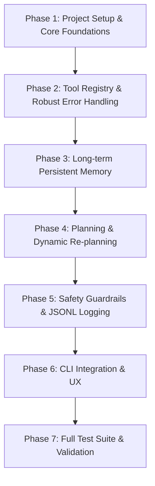

# Execution Plan: AI Study Agent

This document outlines the step-by-step implementation plan for the **AI Study Agent** based on [PRD.md](file:///c:/Users/ACER/Desktop/ai%20agent/PRD.md). Each phase corresponds to architectural milestones and curriculum lessons (L1–L8).

---

## Architecture Overview & File Map

```
study_agent/
├── agent.py        # Core agent loop: think → act → look (L1, L3)
├── tools.py        # Tool registry, schemas, error formatting & execution (L2)
├── planner.py      # Plan generation, interactive approval & dynamic revision (L5)
├── memory.py       # Persistent JSON memory management & pruning (L4)
├── safety.py       # Write confirmations, path sandboxing & step limits (L7)
├── logger.py       # Append-only JSONL run logs (L7)
├── llm.py          # LLM base interface, FakeLLM, and RealLLM client (L8)
├── cli.py          # Command-line interface & interactive runner
├── notes/          # Read-only source notes directory
├── output/         # Sandboxed agent output directory
├── logs/           # JSONL run logs directory
├── memory.json     # Persistent student memory store
└── tests/
    ├── test_loop.py    # Loop, step limits & termination tests
    ├── test_tools.py   # Tool registry, execution & error recovery tests
    ├── test_safety.py  # Path traversal, sandbox & confirmation prompt tests
    ├── test_memory.py  # Memory load, persist, prune & reset tests
    └── test_live.py    # Optional live LLM integration tests (@pytest.mark.live)
```

---

## Phased Execution Roadmap



---

## Detailed Step-by-Step Execution Plan

### Phase 1: Environment Setup & Core Agent Foundations (M1 / L1, L3, L8)
*Goal: Establish the repository layout, LLM abstraction layer (`FakeLLM`), the first tool (`read_notes`), and the basic Think-Act-Look agent loop.*

- [x] **Step 1.1: Project Scaffolding & Directory Setup**
  - Create directory structure: `study_agent/`, `notes/`, `output/`, `logs/`, `tests/`.
  - Create sample notes in `notes/photosynthesis.md` and `notes/mitochondria.md` for testing.
  - Setup `requirements.txt` / dependencies (`pytest`, `python-dotenv`, standard library).
- [x] **Step 1.2: Implement LLM Interface & FakeLLM (`study_agent/llm.py`)**
  - Define `BaseLLM` abstract base class with `generate(prompt: str, context: dict) -> dict`.
  - Implement `FakeLLM` capable of returning pre-scripted responses, simulating tool calls (`{"type": "tool_call", "name": "...", "args": {...}}`), thoughts (`{"thought": "..."}`), and final answers (`{"type": "final_answer", "content": "..."}`).
  - Add support for scripted sequence of responses to test multi-turn loops.
- [x] **Step 1.3: Implement Tool Registry & `read_notes` Tool (`study_agent/tools.py`)**
  - Define `Tool` dataclass containing `name`, `description`, `input_schema`, `risk_level` (`"low"` | `"high"`), and `handler`.
  - Implement `read_notes(filename: str) -> dict`.
  - Validate that `read_notes` properly checks file existence and reads file content.
- [x] **Step 1.4: Implement Minimal Agent Loop (`study_agent/agent.py`)**
  - Implement `run_agent(goal: str, llm: BaseLLM, tools: dict, max_steps: int = 15) -> dict`.
  - Implement Think-Act-Look cycle:
    1. **Think**: Call LLM with goal and history.
    2. **Act**: Dispatch to tool if action requested.
    3. **Look**: Append observation to history.
  - Terminate upon `final_answer` or when reaching `max_steps`.
- [x] **Step 1.5: Unit Test Phase 1 (`tests/test_loop.py`)**
  - Verify `FakeLLM` drives `run_agent` to complete a simple goal using `read_notes`.

---

### Phase 2: Tool Registry & Error Handling (M2 / L2)
*Goal: Complete all 4 required tools with strict schemas, structured error returns, and automatic retry handling.*

- [x] **Step 2.1: Complete the 4 Domain Tools (`study_agent/tools.py`)**
  - Implement `make_quiz(text: str, n: int = 5) -> dict`: Generates structured questions/answers list.
  - Implement `save_file(filename: str, content: str) -> dict`: Flags risk as `"high"`.
  - Implement `update_progress(topic: str, score: float, note: str) -> dict`: Formats progress payload.
- [x] **Step 2.2: Standardize Structured Error Handling**
  - Ensure all tools return structured error dictionaries on failure:
    `{"error": "<type>", "message": "<human-readable>", "hint": "<what to try>"}`.
  - Implement fuzzy matching suggestions for misspelled filenames in `read_notes` (e.g. `bilogy.md` → suggestion: `biology.md`).
- [x] **Step 2.3: Implement Retry Guardrails in Agent Loop**
  - Track consecutive failures for the same tool/intent.
  - Limit retries to a maximum of **2 retries**.
  - If retry limit exceeded, emit a fallback observation prompting the user/agent for guidance rather than crashing.
- [x] **Step 2.4: Unit Tests for Tools & Error Recovery (`tests/test_tools.py`)**
  - Test missing file recovery in `read_notes`.
  - Test retry cap (3rd consecutive failure yields clean failure state).
  - Test calling unknown tools (structured error response).

---

### Phase 3: Persistent Memory (M3 / L4)
*Goal: Store topic progress, weak spots, preferences, and task summaries across sessions in `memory.json`.*

- [x] **Step 3.1: Define Memory Schema & Manager (`study_agent/memory.py`)**
  - Define data structures for:
    - `progress`: `{ [topic: str]: { "score": float, "last_studied": str } }`
    - `weak_spots`: `list[str]`
    - `preferences`: `dict` (e.g. default quiz size)
    - `past_tasks`: `list[{"date": str, "goal": str, "summary": str}]`
  - Implement `load_memory(path: str) -> dict` with corruption recovery (resets to empty schema with warning if JSON is invalid).
  - Implement `save_memory(path: str, data: dict) -> None`.
- [x] **Step 3.2: Implement Pruning & Memory Cap**
  - Cap `past_tasks` to the latest 50 entries to keep LLM context bounded.
- [x] **Step 3.3: Integrate Memory into Agent Prompting**
  - Inject relevant memory context (weak spots, previous scores) into LLM initial prompt.
  - Update memory automatically at the end of a session via `update_progress` observations and task summary generation.
- [x] **Step 3.4: Memory Unit Tests (`tests/test_memory.py`)**
  - Test persistence across simulated sessions (Task 1 saves weak spot → Task 2 receives it).
  - Test graceful recovery on corrupted/missing `memory.json`.

---

### Phase 4: Planning & Plan Revision (M4 / L5)
*Goal: Enforce plan generation before tool execution, interactive user approval, and dynamic plan revision upon tool errors.*

- [x] **Step 4.1: Implement Plan Generator & Model (`study_agent/planner.py`)**
  - Structured plan data model: list of steps with step number, tool name, description, and approval requirement.
  - Format plan for display and prompt injection.
- [x] **Step 4.2: Interactive User Approval Flow**
  - Prompt user with `Approve plan? [y/N/edit]`.
  - If `y`: proceed to execution.
  - If `edit`: allow user to input feedback/modifications and re-plan.
  - If `N` or invalid: abort safely.
- [x] **Step 4.3: Dynamic Plan Revision**
  - In `run_agent`, if a tool fails or unexpected observation occurs, trigger re-planning:
    - LLM analyzes updated state and outputs revised steps.
    - Present updated plan to user before continuing.
- [x] **Step 4.4: Integration Tests for Planning**
  - Verify no tool execution occurs prior to plan approval.
  - Test plan revision flow with `FakeLLM`.

---

### Phase 5: Safety Guardrails & JSONL Logging (M5 / L7)
*Goal: Provide safety boundaries (path traversal prevention, risk confirmations, step limits) and audit logging.*

- [x] **Step 5.1: Path Traversal & Directory Sandboxing (`study_agent/safety.py`)**
  - Implement path sanitizer ensuring `read_notes` can only read from `notes/` directory.
  - Ensure `save_file` can only write to `output/` directory.
  - Reject paths containing `../`, root paths, or absolute traversal attempts.
- [x] **Step 5.2: Confirmation Prompts for High-Risk Actions**
  - Intercept any tool marked High risk (`save_file`).
  - Require explicit `y/n` confirmation displaying the target path and content preview/size.
  - Default answer must be **No**.
  - If declined, inform agent via observation so it can adapt (e.g. print content to screen instead of writing).
- [x] **Step 5.3: Hard Step Cap**
  - Enforce strict 15-step cap in `agent.py`. Stop gracefully and report partial progress when exceeded.
- [x] **Step 5.4: Append-Only JSONL Logging (`study_agent/logger.py`)**
  - Create daily log files: `logs/YYYY-MM-DD.jsonl`.
  - Log each step: `{timestamp, step_num, thought, tool, args, result_or_error, user_decisions}`.
  - Ensure sensitive credentials (API keys) are masked/omitted from logs.
- [x] **Step 5.5: Safety Unit Tests (`tests/test_safety.py`)**
  - Test path traversal attempts (e.g. `../../etc/passwd`).
  - Test declined user confirmation on `save_file`.
  - Test step limit cutoff at 15 steps.

---

### Phase 6: Command Line Interface & CLI UX (CLI Entry Point)
*Goal: Provide an intuitive, polished CLI for students with goal arguments and administrative flags.*

- [x] **Step 6.1: Implement CLI Arguments & Options (`study_agent/cli.py`)**
  - Support: `python -m study_agent.cli "<goal>"`
  - Support flags:
    - `--show-memory`: Display current stored topics, weak spots, and preferences.
    - `--reset-memory`: Clear `memory.json` after confirmation.
    - `--max-steps <int>`: Customize max steps (default: 15).
    - `--mock` / `--live`: Switch between `FakeLLM` (for demos/tests) and `RealLLM`.
- [x] **Step 6.2: Terminal Output Formatting**
  - Clear formatting for `[step N] think → act → look`.
  - Clean warnings for high-risk write operations.
  - Final execution summary with log file link.

---

### Phase 7: Real LLM Integration & Test Suites (M6 / L8)
*Goal: Connect a production LLM client and validate end-to-end deterministic and live behavior.*

- [x] **Step 7.1: Implement Real LLM Client (`study_agent/llm.py`)**
  - Implement `RealLLM` using an official LLM SDK (e.g. Gemini API or OpenAI API).
  - Read API key from environment variables (`.env`).
  - Format system prompts, tool schemas, memory, and conversation history into LLM messages.
  - Parse tool calls from model output cleanly.
- [x] **Step 7.2: Fake LLM Deterministic Test Suite**
  - Complete `pytest` test suite covering 100% of functional requirements (FR1–FR7) without network calls.
  - Ensure all tests run fast, offline, and reproducibly.
- [x] **Step 7.3: Real LLM Live Suite (`tests/test_live.py`)**
  - Create 3–5 behavioral test cases marked with `@pytest.mark.live`.
  - Verify behavior: plan generated, tools invoked within limits, confirmation respected.
- [x] **Step 7.4: Final Polish & Verification**
  - Codebase review against Non-Functional Requirements:
    - Total core agent code under ~500 lines of Python.
    - Modular architecture mapping directly to L1–L8.
    - Verify zero unauthorized writes.

---

## Verification & Acceptance Checklist

| Requirement | Verification Method | Status |
|---|---|---|
| **FR1: Agent Loop** | `test_loop.py`: runs think → act → look cycle, terminates on `final_answer` | Completed |
| **FR2: Tool Registry** | `test_tools.py`: all 4 tools execute, unknown tools return structured errors | Completed |
| **FR3: Error Recovery** | `test_tools.py`: retries bad file up to 2 times and self-corrects | Completed |
| **FR4: Persistent Memory** | `test_memory.py`: persists across tasks, caps at 50, `--show/--reset-memory` works | Completed |
| **FR5: Planner** | `test_planner.py`: requires plan approval before actions, re-plans on tool errors | Completed |
| **FR6: Safety & Sandboxing** | `test_safety.py`: blocks `../`, enforces default-No write prompt, caps at 15 steps | Completed |
| **FR7: Testing Suite** | `pytest` runs green offline; `pytest -m live` passes with real API key | Completed |

